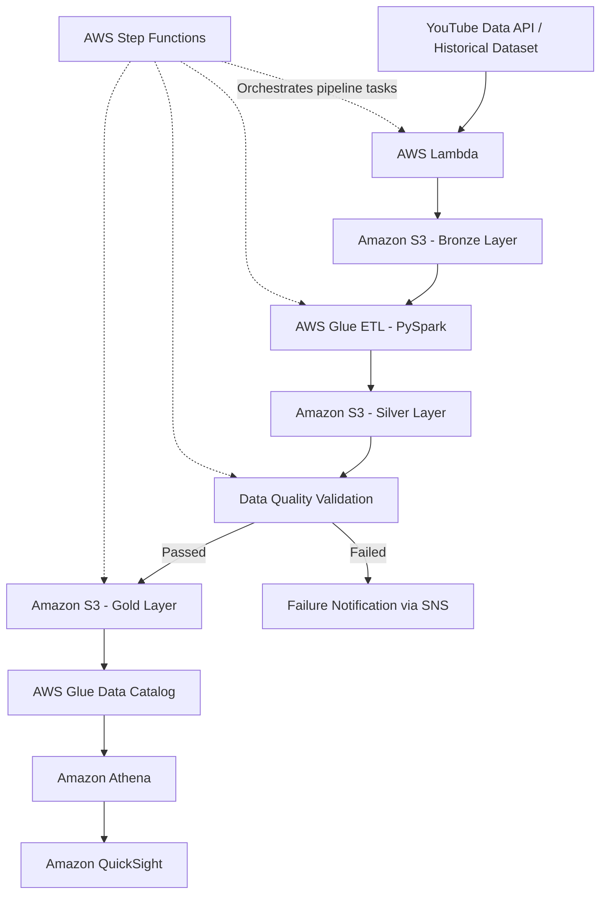

# YouTube Trending Data Engineering Pipeline on AWS

An end-to-end data engineering project that demonstrates how to ingest, store, transform, validate, and analyze YouTube trending video data using AWS services.

## Project Overview

YouTube generates a large amount of video metadata, including video titles, channels, categories, views, likes, comments, and trending information. Analyzing this data can help identify content trends and understand how video performance varies across countries and categories.

The goal of this project is to build an AWS-based data engineering pipeline that organizes YouTube trending data into structured, analytics-ready datasets.

The pipeline follows an ETL (Extract, Transform, Load) approach:

1. **Extract:** Collect YouTube trending data from available data sources.
2. **Load:** Store raw data in Amazon S3.
3. **Transform:** Clean, standardize, deduplicate, and enrich the data using AWS data processing services.
4. **Validate:** Apply data quality checks before making processed data available for analysis.
5. **Analyze:** Query the processed datasets using Amazon Athena and use the results for business intelligence in Amazon QuickSight.

The project demonstrates how individual data processing tasks can be organized into a maintainable, cloud-based workflow.

## Business Problem

Suppose a company wants to understand YouTube content trends before planning its advertising campaigns.

The company needs to answer questions such as:

- Which video categories attract the most views?
- Which channels perform well across different countries?
- How does engagement vary between videos?
- What types of content frequently appear in trending lists?
- How can large volumes of video data be processed efficiently?
- How can the data pipeline detect invalid or incomplete records?

Manually downloading and analyzing files repeatedly is difficult to maintain as data volume grows.

This project addresses these challenges by organizing data ingestion, cloud storage, ETL processing, data validation, and analytics into a structured pipeline.

## Project Objectives

- Build an end-to-end data pipeline using AWS services.
- Store raw and processed datasets in Amazon S3.
- Transform data into clean, structured formats suitable for analytics.
- Implement a Bronze, Silver, and Gold data lake architecture.
- Apply data quality checks to improve data reliability.
- Orchestrate pipeline tasks using AWS Step Functions.
- Query processed data using Amazon Athena.
- Support business intelligence and dashboard development using Amazon QuickSight.
- Understand cloud storage, serverless processing, access management, and workflow orchestration.

## Architecture

The following diagram illustrates the target end-to-end architecture of the project.



**Architecture note:** The diagram describes the intended workflow. The YouTube API, historical dataset, orchestration, notification, and dashboard components require their corresponding configurations and AWS resources to be implemented and enabled in your environment.

## Technology Stack

| Technology | Purpose |
|---|---|
| Python | Data ingestion and supporting processing logic |
| AWS Lambda | Serverless execution of ingestion and validation tasks |
| Amazon S3 | Storage for raw, processed, and analytics-ready datasets |
| AWS Glue | Managed ETL processing |
| PySpark | Distributed data transformation |
| AWS Glue Data Catalog | Table metadata and schema management |
| AWS Step Functions | Workflow orchestration |
| Amazon Athena | SQL queries directly against data stored in S3 |
| Amazon QuickSight | Interactive analytics and dashboards |
| Amazon SNS | Notifications for configured pipeline failures |
| AWS IAM | Permissions and access control |

## Data Pipeline Workflow

### 1. Data Ingestion

The pipeline starts by collecting YouTube trending video data.

Depending on the configured ingestion method, the source can include:

- YouTube Data API data.
- Historical YouTube trending CSV datasets.
- Video category metadata stored in JSON files.

AWS Lambda can execute ingestion logic and write incoming records to Amazon S3.

The raw data is retained in the Bronze layer so that the original input can be preserved separately from subsequent transformations.

### 2. Raw Data Storage — Amazon S3

Amazon S3 serves as the central data lake storage layer.

The data is organized into logical layers to separate raw input from transformed and analytics-ready data.

This separation makes it easier to troubleshoot processing issues and manage changes to transformation logic.

### 3. ETL Processing — AWS Glue and PySpark

AWS Glue processes the raw datasets using ETL jobs.

Typical transformations include:

- Handling missing and invalid values.
- Standardizing column names and data types.
- Removing duplicate records.
- Parsing and standardizing timestamps.
- Joining video records with category metadata.
- Calculating useful engagement metrics.
- Writing processed data into analytics-friendly formats.

For example, an engagement metric could be calculated as:

`Engagement Rate = (Likes + Comments) / Views × 100`

The precise calculation depends on the selected business definition and the availability of the relevant columns.

### 4. Data Quality Validation

Data quality checks help ensure that downstream analytics use reliable data.

The pipeline can validate:

- Required columns and expected schema.
- Null values in important fields.
- Duplicate records.
- Valid numeric values.
- Data consistency and transformation results.
- Whether the processed output meets the defined validation rules.

If validation fails, the workflow can be configured to stop downstream processing and send a notification through Amazon SNS.

### 5. Workflow Orchestration — AWS Step Functions

AWS Step Functions coordinates the pipeline's processing stages.

It can manage task execution order, handle failures, apply retry policies, and track the status of individual steps.

Orchestration helps turn a collection of independent processing scripts into a repeatable workflow.

### 6. Querying and Analytics

Once the data has been transformed and made available in the Gold layer, Amazon Athena can query the files directly in Amazon S3 using SQL.

The resulting datasets can be connected to Amazon QuickSight to build dashboards and explore video trends, channel performance, and category-level metrics.

## Medallion Architecture

The project uses the Bronze, Silver, and Gold pattern to separate data according to its processing stage.

### Bronze Layer — Raw Data

**Purpose:** Preserve source data with minimal transformation.

Contains the ingested data in its original or near-original form, making it useful for reprocessing and troubleshooting.

### Silver Layer — Cleaned Data

**Purpose:** Create reliable, standardized datasets.

Contains data that has undergone cleaning, type conversion, deduplication, metadata enrichment, and other required transformations.

### Gold Layer — Analytics-Ready Data

**Purpose:** Support reporting and business analysis.

Contains curated datasets or aggregations designed for common analytical questions, such as trending performance, channel comparisons, and category-level insights.

The exact tables and output formats depend on the ETL jobs implemented in the project.

## Data Quality Checks

Data quality is important because incorrect or incomplete records can lead to misleading analytics.

Examples of checks that can be implemented include:

| Check | Objective |
|---|---|
| Schema validation | Confirm that required fields exist |
| Null validation | Identify missing values in important columns |
| Duplicate detection | Prevent duplicate records from distorting results |
| Data type validation | Ensure numeric and date fields have appropriate types |
| Business rule validation | Check that metrics satisfy defined rules |
| Pipeline status validation | Prevent downstream processing when required checks fail |

The checks should be configured according to the actual source schema and business requirements.

## Analytics and Business Insights

The processed data can support questions such as:

- **Category analysis:** Which video categories account for the largest share of views?
- **Channel analysis:** Which channels receive the most views across the selected regions?
- **Engagement analysis:** How do likes and comments relate to video views?
- **Regional analysis:** How do trending patterns differ between countries?
- **Trend analysis:** How does video performance change over time?

Amazon Athena can be used to write SQL queries against the curated data, while Amazon QuickSight can present the results through charts, tables, and dashboards.

These are analytical use cases supported by the pipeline design; actual findings should be reported only after running queries against the processed data.

## Project Structure

The repository is organized into the following main components:

```text
youtube-video-suggestion-end-to-end-aws-data-pipeline/
│
├── data_quality/       # Data quality validation logic
├── dataset/
│   └── archive/        # Dataset metadata and category reference files
├── glue_jobs/          # AWS Glue ETL scripts
├── iam_permission/     # IAM permissions and policy references
├── lambda/             # Lambda functions
├── step_functions/     # Workflow orchestration definitions
├── .gitignore          # Files excluded from Git tracking
└── README.md           # Project documentation
```

The purpose of each component is summarized above. Refer to the files within each directory for the specific implementation, configuration, and execution details.

## Dataset

The project uses YouTube trending video data and category metadata.

The historical dataset contains country-specific CSV files and category information. The original CSV dataset and ZIP archive are not included in this GitHub repository because of their file sizes.

### Getting the data

1. Obtain the YouTube trending dataset from the relevant source used by your project.
2. Extract the archive locally.
3. Place the CSV files in the expected local dataset directory.
4. Keep the category JSON files alongside the dataset where required by the transformation logic.
5. Configure the appropriate local path or Amazon S3 location before executing the pipeline.

The historical data can be used for testing and batch processing. If YouTube API ingestion is configured, API credentials and ingestion settings must be provided separately.

**Important:** The exact file paths and source configuration should match the scripts in this repository.

## AWS Setup and Execution

The following is the high-level setup sequence for running the project. Actual resource names, IAM policies, paths, and job parameters must match the configuration in the repository.

### Prerequisites

- An AWS account with permission to create and configure the required services.
- Python and the dependencies required by the project.
- Amazon S3 buckets for the data lake.
- AWS IAM roles and policies for service access.
- AWS Lambda functions and AWS Glue jobs.
- AWS Step Functions state machine if orchestration is enabled.
- AWS Glue Data Catalog and Amazon Athena configuration.
- Amazon QuickSight setup if dashboards are required.
- Amazon SNS topic and subscriptions if failure notifications are enabled.

### Setup sequence

1. **Configure IAM:** Create appropriate roles and permissions for the services that need access to S3 and other AWS resources.
2. **Create S3 storage locations:** Configure separate locations for the Bronze, Silver, and Gold layers.
3. **Prepare the source data:** Download the historical dataset or configure the YouTube API ingestion settings.
4. **Configure Lambda:** Set up the ingestion and data quality functions with the required environment variables and permissions.
5. **Configure AWS Glue:** Set up the ETL jobs, their scripts, input/output locations, and required job parameters.
6. **Configure orchestration:** Set up the Step Functions state machine to execute the required tasks in the correct order.
7. **Configure the Data Catalog and Athena:** Define or discover the tables and configure the Athena query results location.
8. **Run and validate:** Execute the pipeline and inspect the job logs, output files, and data quality results.
9. **Build dashboards:** Connect QuickSight to the relevant analytics tables and create visualizations where required.

Do not assume the pipeline is deployed simply because its scripts are present in the repository. The AWS resources must be configured and the workflow executed successfully.

## Security Considerations

- Never commit AWS access keys, secret keys, API keys, or passwords.
- Use IAM roles and least-privilege permissions wherever possible.
- Store secrets using an appropriate secrets-management mechanism.
- Keep large datasets and confidential information out of GitHub unless there is a clear reason and permission to publish them.
- Review CloudWatch logs and service permissions when troubleshooting failures.
- Review AWS resource usage and pricing to avoid unexpected charges.

## Learning Outcomes

This project provides practical experience with:

- Building an end-to-end data engineering workflow.
- Working with structured and semi-structured data.
- Using Amazon S3 as a data lake.
- Writing ETL transformations with Python and PySpark.
- Implementing data quality validation.
- Understanding Bronze, Silver, and Gold data layers.
- Orchestrating processing tasks with AWS Step Functions.
- Querying cloud data using SQL and Amazon Athena.
- Preparing curated datasets for business intelligence.
- Applying AWS IAM and cloud security principles.

